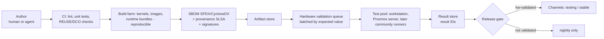

# Delivery, Image, Updates and Build Pipeline

> Status: Phase 0 proposal (not implemented) · Last updated: 2026-11-26 · Related ADRs: 0005, 0006, 0009, 0010 · Evidence: `docs/research/05-base-distributions-and-licensing.md` [D-*], `docs/research/02-kernel-and-os.md` [K-*]

## Summary

- **Layer first, image later** (ADR-0005). Phases 1–2 ship AI Linux as a
  distro-agnostic layer on Ubuntu 26.04 LTS (primary) and a few secondary
  hosts. An own image is prototyped in CI only and released no earlier than
  Phase 3, on a base chosen by measured experiments.
- **Kernel policy**: follow a recent stable kernel rather than an old LTS for
  the image track — sched_ext sub-schedulers (since 7.1, feature-complete 7.3), dmem reclaim (7.3), cache-aware scheduling
  (7.2) and several production scx schedulers (≥6.16) are recent [K-09][K-14][K-19].
  In layer mode, the host's kernel is used and capability-detected.
- **Atomic updates with automatic rollback** via upstream mechanisms (bootc /
  OSTree, or mkosi images with A/B, plus systemd boot counting and
  greenboot-style health checks) [D-34][S-39][S-40][S-43].
- **Build-heavy / deferred validation** (ADR-0010): reproducible CI builds with
  SBOM and provenance; hardware validation in batches; release channels gated
  by validation state.

## 1. Layer mode (Phases 1–2)

| Artifact | Form | Notes |
|----------|------|-------|
| `ailx` CLI, `ailxd` daemon, probes, harness | Native packages (deb first, rpm next) or a self-contained install with systemd units | Privileged parts minimal; polkit-gated IPC |
| Runtime bundles (llama.cpp, vLLM, ComfyUI, …) | OCI images pinned by digest, run with Podman (rootless where possible); GPU access via CDI | Identical bundles across distros and arms (ADR-0006). Models bind-mounted read-only |
| sched_ext scheduler profiles | Distribution `scx` packages where available; otherwise project-built, signed, GPL-2.0 BPF objects + loader | Kernel must have `CONFIG_SCHED_CLASS_EXT`; detect at runtime (open question: stock Ubuntu/Debian/Fedora config) |
| Host-level additions | systemd-sysext / confext images where they fit; `ID` matching limits portability [D-76] | Experiment E-08 measures how many per-distro artifacts are needed |
| Knob profiles | Declarative files consumed by `ailxd`; TuneD as an optional backend | No persistent change without journal + revert path |

Host support matrix (initial): **Ubuntu 26.04 LTS** (tier 1, baseline);
Fedora 45, Debian 13, Arch/CachyOS, NixOS (tier 2, best effort, bake-off
hosts). The matrix stays small on purpose.

## 2. Own image (Phase 3+, base decided by ADR after bake-off)

**Candidates** (CI prototypes only until the decision): Fedora bootc, Debian +
mkosi; Ubuntu + mkosi as control. Decision inputs: experiments E-01…E-09 in
`docs/research/05-base-distributions-and-licensing.md` §1.9.

**Target properties**

| Property | Approach | Evidence / note |
|----------|----------|-----------------|
| Atomic update + rollback | bootc/OSTree deployments, or A/B image slots (systemd-sysupdate-style) | [D-34][S-43] |
| Boot assessment | systemd boot counting (`+N` tries, `boot-complete.target`), health checks: GPU visible, driver loaded, smoke inference within latency budget, KLD gate | [S-39][S-40] |
| Kernel | Recent stable series with `SCHED_CLASS_EXT`; PREEMPT_LAZY (x86 default) [K-05]; config deltas from the distro kernel documented and individually justified by measurements | AutoFDO/Propeller/ThinLTO only if H-K-07 is refuted [K-52][K-53] |
| ISA builds | x86-64-v3/v4 package builds only if E-01 shows a benefit beyond noise with unchanged outputs; the kernel itself barely benefits (`-mno-sse -mno-avx`) [K-54] | H-D-01 |
| NVIDIA | Open kernel modules built and signed in CI (MIT/GPLv2 dual) [D-60]; userspace and GSP firmware fetched on demand from distro/NVIDIA repos, version-matched [D-59] | Optional component (ADR-0004) |
| AMD / Intel | Upstream amdgpu/xe drivers; ROCm/oneAPI userspace via distro packages or bundles | ROCm 10 is TheRock-based [R-33][R-34] |
| Secure Boot | Shim + distro/project signing; module signing in CI; MOK enrollment only as fallback; lockdown stays on | Lockdown blocks debugfs/MSR tuning, so knobs must use sysfs/sysctl/cgroups [K-61] |
| Security defaults | No security-reducing defaults (ADR-0004); knob classification per [K-*] security table | |

## 3. Build pipeline

- **Reproducibility**: pinned inputs, hermetic builds where feasible,
  rebuild comparison (diffoscope) as in E-07; Debian and Arch show this is
  achievable at distribution scale [D-10][D-25].
- **Supply chain**: SBOM in SPDX 3.0.1 or CycloneDX 1.7 [D-82][D-83]; SLSA
  Build L2 early, L3 with a hardened builder [D-81]; signing of images and
  bundles (Sigstore/cosign is a candidate — not yet researched).
- **Channels**:
  - `nightly` — built and unit-tested, not hardware-validated; never default.
  - `testing` — hardware-validated on ≥1 reference target; quality and
    stability gates passed.
  - `stable` — validated on all reference targets incl. soak; tuning defaults
    only from `hw-validated` ledger rows (ADR-0010).

## 4. Compliance and security process

- `SECURITY.md` with private reporting channel and embargo policy before the
  first code release; CVE pathway.
- EU Cyber Resilience Act: manufacturer reporting applies since 2026-09-11;
  open-source steward obligations most likely from December 2027 (sources
  disagree) — steward status needs legal review [D-89][D-90][D-91].
- Licence posture of shipped components per
  `docs/research/05-base-distributions-and-licensing.md` §2.7: no
  redistribution of CUDA/cuDNN/TensorRT or model weights by default.

## Open questions

Tracked in `docs/state/open-questions.md` ("Delivery and image").
