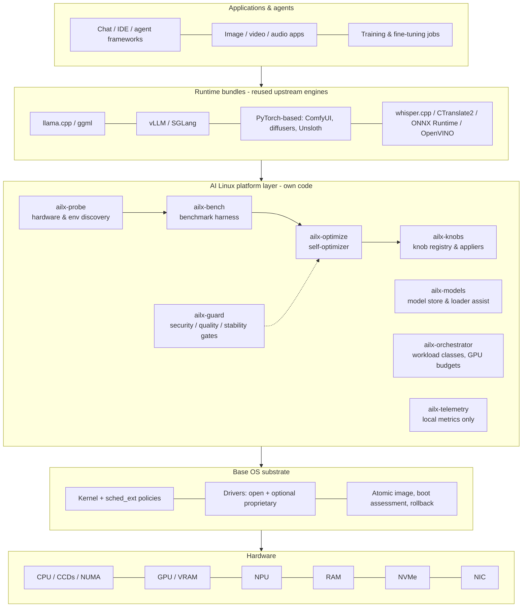

# Architecture Overview

> Status: Phase 0 proposal (not implemented) · Last updated: 2026-11-26 · Related ADRs: 0004, 0005, 0006, 0007, 0008, 0010

## Summary

- AI Linux is designed as a **measured, self-optimizing platform layer** first
  and a **distribution image** second (ADR-0005). The core ("ailx") must run on
  existing distributions so that every optimization can be measured against an
  Ubuntu baseline on the same machine before it is baked into an image.
- The architecture **abstracts management, not compute** (ADR-0007): vendor
  compute stacks (CUDA, ROCm/HIP, oneAPI/Level Zero, Vulkan, NPU runtimes) and
  engines (llama.cpp, vLLM, SGLang, PyTorch, ComfyUI, …) are reused as
  pluggable bundles. AI Linux owns discovery, placement, tuning, measurement,
  policy and lifecycle.
- The first component to build is the **benchmark harness + hardware probe**,
  because every later decision (base distro, kernel, tuning defaults) depends on
  trustworthy measurements.
- Self-optimization is **safety-tiered** (ADR-0008): runtime-reversible knobs
  are explored automatically; boot- and image-level changes go through new boot
  entries/generations with automatic boot assessment and rollback; security-
  reducing and lossy knobs are never auto-adopted (ADR-0004).
- Everything is described by **versioned, declarative manifests** (hardware
  profile, environment fingerprint, knob, tuning profile, runtime bundle,
  workload, result, generation), so that results are reproducible and
  shareable (opt-in).

## Design goals

| ID | Goal | Measurable criterion (Phase 1+) |
|----|------|---------------------------------|
| G1 | Performance | Statistically significant improvement over the Ubuntu baseline (ADR-0006) on the reference workloads, reported with confidence intervals |
| G2 | Quality invariance | Every auto-adopted change passes the quality gate (`benchmarking.md`) |
| G3 | Stability | No regression in soak/stability suite; every change has a tested rollback path |
| G4 | Hardware agnosticism | Vendor-specific code isolated in providers; core has no vendor imports |
| G5 | Modularity | Components communicate via versioned schemas/APIs and are individually replaceable |
| G6 | Local-first & privacy | Works fully offline; zero default network egress from platform services |
| G7 | Reproducibility | Any result can be re-run from its manifests (pinned versions, hashes) |
| G8 | Openness | All own code under OSI licenses (ADR-0009, proposed) |

## Layer model

Interpretation: L2 is the project's own contribution. L1 starts as "whatever
distro the user runs" (layer mode) and becomes an AI Linux image later. L3 is
reused and pinned; L4 is out of scope except for reference workloads.

## Components

| Component | Responsibility | Reuses (candidates) | Own code | First phase |
|-----------|----------------|---------------------|----------|-------------|
| **ailx-probe** | Discover CPU topology (CCDs, L3, ISA), memory, GPUs/NPUs, PCIe links, storage, power interfaces, firmware; emit *Hardware Profile* and *Environment Fingerprint* | hwloc, sysfs/procfs, lspci, NVML, amd-smi/amdsmi, Level Zero/xpu-smi, nvme-cli, dmidecode | Schema, collectors, normalization | 1 |
| **ailx-bench** | Run declarative workloads, sample telemetry, compute statistics, store results, run quality checks | llama-bench, `vllm bench`, GuideLLM, lm-evaluation-harness, llama-perplexity (KLD), fio, stress-ng | Manifests, orchestration, interleaving, statistics, results store | 1 |
| **ailx-telemetry** | Local samplers: GPU energy/power/clocks/memory, CPU energy (RAPL), PSI, perf counters, thermals | NVML/DCGM, amdsmi, powercap, PSI, perf, Prometheus exporters | Unified sampler + timestamps aligned with benchmark phases | 1 |
| **ailx-knobs** | Registry of tunables with metadata; apply/verify/revert per knob | sysfs/sysctl, systemd (slices, CPUAffinity), TuneD (as backend), scx loader, NVML/amd-smi controls | Registry schema, appliers, revert journal | 2 |
| **ailx-guard** | Enforce invariants: knob classes, quality gate, stability gate, dead-man revert timers | systemd timers, boot assessment | Policy engine | 2 |
| **ailx-optimize** | Experiment controller: propose → stage → measure → decide → adopt/rollback; generation history | Optuna/BoTorch (search), change-point detection libs | Controller, decision rules, generation store | 2 |
| **ailx-models** | Content-addressed model store, integrity, provenance, fetch-on-demand (opt-in network), prefetch/warm | safetensors, GGUF, HF hub client, fastsafetensors / Run:ai Model Streamer where engines support them | Store layout, metadata, prefetch policies | 2–3 |
| **ailx-orchestrator** | Workload classes (interactive / batch / background), cgroup slices, VRAM budgets & admission control, model swap | systemd, cgroup v2, Podman/OCI, llama-swap-like routers | Policy + placement | 3–4 |
| **Runtime bundles** | Pinned engine builds per backend with SBOM | OCI images, systemd-sysext, Nix closures (TBD) | Build recipes, compatibility metadata | 2–3 |
| **Base image** | Kernel config, sched_ext policies, drivers, atomic updates, boot assessment | Base distro (ADR-0005 bake-off), mkosi/bootc/etc. | Image recipes | 3 |

## Data model (versioned schemas)

| Artifact | Content (abridged) | Produced by | Consumed by |
|----------|-------------------|-------------|-------------|
| **Hardware Profile** | CPU (vendor, model, CCD/L3 layout, ISA extensions, NUMA), memory (size, speed, channels if detectable), GPUs (vendor, arch, VRAM, PCIe gen/width, ReBAR, driver), NPUs, storage (interface, gen/width), power interfaces | probe | optimizer, planner, results |
| **Environment Fingerprint** | Kernel version + cmdline, distro, driver/firmware/microcode/BIOS versions, active knobs, runtime bundle digests, model hashes, ambient conditions if available | probe | every result record |
| **Knob** | id, mechanism, level, scope, value domain, default, reversibility (runtime / reboot / image), `security_class` (allowed / opt-in / forbidden), `quality_class` (lossless / lossy / n.a.), preconditions, conflicts, evidence refs, validation status | maintainers / community | knobs, optimizer, guard |
| **Tuning Profile** | Set of knob assignments + applicability predicate (hardware, workload class) + provenance (result IDs) | optimizer / maintainers | knobs |
| **Runtime Bundle** | Engine, version, backend, build flags, image digest, SBOM, supported formats | build pipeline | bench, orchestrator |
| **Workload Manifest** | Type, runtime bundle, model ref (hash), parameters, load pattern + dataset hash, metrics, quality check, duration | maintainers | bench |
| **Result Record** | Run ID, fingerprint hash, profile, workload, raw samples, summary stats, quality outcome, stability events, energy | bench | optimizer, reports, (opt-in) community DB |
| **Generation** | Image version + active profile + status (candidate / active / previous / failed) + rollback pointer | optimizer / image | guard, boot assessment |

## Control and privilege model (proposal)

- A small privileged service (`ailxd`) is the only component that changes
  system state (sysfs, sysctl, scheduler attach, GPU power limits). It exposes
  a narrow local IPC API (D-Bus or varlink; decision deferred) gated by polkit.
- CLI, benchmark runners and workloads run unprivileged in dedicated cgroups.
- Every state change is journaled with its inverse operation; runtime-tier
  changes are protected by a dead-man timer (auto-revert unless confirmed by
  a passing health check).
- No component opens network connections unless the user configured a
  network-requiring action (model download, opt-in result upload).

## Deployment modes

| Mode | Description | Phase |
|------|-------------|-------|
| **Layer mode** | ailx installed on an existing distro (Ubuntu LTS for baseline comparisons; Fedora/Arch/Debian/NixOS for bake-off) | 1–2 |
| **Appliance image** | AI Linux image on the chosen base, atomic updates, boot assessment, curated kernel + sched_ext policies, runtime bundles | 3+ |
| **Companion / cluster mode** | Several nodes (e.g. workstation + server) with shared model cache, remote benchmark control, optional distributed inference | 4+ |

## Workload classes and resource policy (target design)

| Class | Examples | CPU policy | Memory policy | GPU policy |
|-------|----------|-----------|---------------|------------|
| Interactive | chat, code completion, voice | high weight, latency-oriented scheduler hints | protect hot weights from eviction (`memory.min`) | priority on VRAM admission, preempt batch where engine supports it |
| Batch | embeddings, bulk generation, transcription | normal | normal | throughput-oriented batching |
| Background | fine-tuning, training, indexing | low weight / idle | `memory.high` limits | yields VRAM on demand (checkpoint/stop) |
| System | ailx services, desktop | protected minimal share | small reserved | none |

Consumer GPUs (e.g. GeForce) lack hardware partitioning such as MIG, so GPU
sharing relies on cooperative VRAM budgets, admission control and model
swapping (details in `docs/research/04-runtimes-and-workloads.md`).

## Where the innovation is (and is not)

Not new (reuse): inference engines, quantization formats, drivers, schedulers
themselves, image tooling, optimizers. New (the project's contribution):

1. A **closed, quality-gated, rollback-safe tuning loop** that spans kernel,
   system, GPU and runtime knobs for local AI workloads.
2. A **knob registry with security/quality/reversibility metadata** and
   hardware applicability — a shared, evidence-linked knowledge base.
3. **AI-workload-aware CPU scheduling and placement policies** (sched_ext),
   e.g. for MoE CPU-offload and GPU-feeder threads on asymmetric-cache CPUs.
4. **Fast model lifecycle** on consumer hardware (loading, swapping,
   multi-workload VRAM arbitration).
5. **Reproducible, comparable public results** (opt-in) keyed by hardware
   profile and environment fingerprint.

Prioritization and evidence: `docs/research/07-opportunity-matrix.md`.

## Related documents

- `hardware-abstraction.md` — provider model for NVIDIA/AMD/Intel/NPU/future
- `self-optimization.md` — tuning loop, safety tiers, rollback
- `benchmarking.md` — methodology with Ubuntu baseline
- `hardware-test-plan.md` — first tests on the workstation and Proxmox server
- `image-and-delivery.md` — layer-first delivery, image, updates, build pipeline
- `community-and-licensing.md` — license set, governance, contribution model
