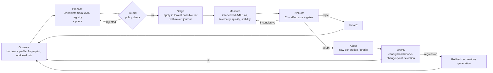

# Self-Optimization: Closed-Loop Tuning with Safe Adoption and Rollback

> Status: Phase 0 proposal, amended by Phase 0.1 review · Last updated: 2026-11-26 · Related ADRs: 0004, 0008 · Evidence: `docs/research/06-self-optimization-and-benchmarking.md`

## Summary

- The self-optimizer is an **experiment controller**, not a magic tuner: it
  proposes configurations from a **registry of known knobs**, measures them with
  the benchmark harness, decides with explicit statistical rules, adopts
  winners, keeps a generation history and rolls back on regressions.
- Every knob has **safety metadata** (security class, quality class,
  reversibility). The optimizer only ever explores knobs that are
  `security_class = allowed` and `quality_class ∈ {lossless, n.a.}` on its own.
- Changes are staged by **tier**: process-level → runtime system-level (with
  dead-man auto-revert) → boot-level (new boot entry with automatic boot
  assessment) → image-level (new generation/A-B slot).
- The design deliberately **reuses** existing mechanisms: TuneD-style profiles
  [S-01][S-02], sched_ext's runtime attach/detach with kernel fallback
  [S-44][K-08], systemd automatic boot assessment and greenboot-style health
  checks [S-39][S-40], image rollback of the chosen base [S-43], an
  off-the-shelf optimizer library (Optuna or Ax/BoTorch) for search
  [S-22][S-24], and E-Divisive change-point detection (Apache Otava)
  [S-53][S-55]. No existing tool closes the whole loop (`06-self-optimization-and-benchmarking.md` F1–F5).
- Decision thresholds below (effect sizes, repetitions) are **initial policy
  choices to be calibrated in Phase 1 with A/A tests**, not evidence-backed
  constants.

## Control loop

## Knob registry

Each knob (examples, not validated defaults):

| Field | Example: THP mode | Example: sched_ext policy | Example: GPU power limit | Example: KV-cache type |
|-------|-------------------|---------------------------|--------------------------|------------------------|
| level | kernel-runtime | kernel-runtime | driver-runtime | runtime |
| mechanism | `/sys/kernel/mm/transparent_hugepage/enabled` | attach scx scheduler via loader | NVML/`nvidia-smi -pl` | engine flag |
| reversibility | runtime | runtime (kernel falls back to fair class on error/detach) | runtime | process restart |
| security_class | allowed | allowed | allowed | allowed |
| quality_class | n.a. | n.a. | n.a. | **lossy** if quantized (f16 → q8/q4) |
| auto-explore | yes | yes | yes | **no** (opt-in only) |

Security classes (ADR-0004):

- `allowed` — no reduction of security properties.
- `explicit-opt-in` — measurable security or stability trade-off (e.g. IOMMU
  passthrough, unprivileged perf events, GPU over-clocking). Never proposed
  autonomously; only applied after the user acknowledges a displayed risk text,
  per machine.
- `forbidden` — never applied by AI Linux tooling (e.g. `mitigations=off` as a
  default, disabling Secure Boot/lockdown or LSMs). Documented with evidence for
  transparency only.

The classification of concrete kernel knobs is in
`docs/research/02-kernel-and-os.md` ("Security classification of tuning knobs").

## Safety tiers (ADR-0008, proposed)

| Tier | Scope | Examples | Apply | Revert mechanism | Who may adopt |
|------|-------|----------|-------|------------------|---------------|
| T0 | Process / runtime config | thread counts, batch sizes, offload split, CUDA graphs on/off | restart workload | previous config | optimizer (lossless only) |
| T1 | System runtime | sysctl, THP, EPP/governor, sched_ext policy, IRQ affinity, GPU power limit, cgroup weights | `ailxd` | revert journal + **dead-man timer** (auto-revert unless a post-change health check confirms) | optimizer (allowed + lossless) |
| T2 | Boot | kernel cmdline, kernel build/config, module params | new boot entry | **automatic boot assessment** (boot counting) + health checks → fall back to last good entry | optimizer proposes, user/maintainer confirms by default |
| T3 | Image | base image, drivers, runtime bundle versions | new generation / A-B slot | image rollback of the base system | release process (maintainers) |

## Operating rules borrowed from bpftune [S-04]

- **Yield to the administrator**: if a managed knob was changed manually, the
  optimizer stops managing it and reports this.
- **Explain every change**: append-only journal entry with knob, old value,
  new value, reason, evidence/result ID and rollback handle.
- **Small privileged surface**: TuneD's local privilege-escalation CVEs show
  that a root tuning daemon is attack surface [S-01] (RK-07).

## Coexistence and lockdown rules (Phase 0.1 review)

- **Other tuning agents**: before managing a knob, detect services that manage
  the same knob (TuneD, power-profiles-daemon, irqbalance, thermald, desktop
  power managers, distro `scx` loaders). Either take over explicitly with user
  consent (and record it in the fingerprint) or leave the knob unmanaged —
  never fight another daemon.
- **Lockdown-incompatible knobs**: knobs that need debugfs writes or MSR access
  (e.g. `SCHED_CACHE`'s `llc_balancing/*` [V-01]) cannot be applied under
  Secure Boot lockdown [K-61]. The registry marks them
  `requires: lockdown=none`; they are `explicit-opt-in`, never auto-applied,
  and the planner prefers lockdown-compatible substitutes (e.g. cpusets/CPU
  affinity to bound `SCHED_CACHE` aggregation, H-K-11).
- **Probation**: a T1 adoption becomes persistent only after a probation
  period (soak subset) without stability events — dead-man timers catch
  immediate failures, probation catches delayed ones (memory policy → OOM
  after hours).

## Search strategy

1. **Priors**: start from the community/maintainer profile matching the
   hardware profile (opt-in data; offline bundles shipped with releases).
2. **Screening**: one-factor-at-a-time and small fractional-factorial designs to
   find influential knobs cheaply (most knobs will have no measurable effect —
   that result is valuable and is recorded). Screening p-values are corrected
   with Benjamini–Hochberg (FDR); screening results never lead to adoption
   directly — only to a confirmatory campaign with fresh data.
3. **Refinement**: noise-aware Bayesian optimization (single objective, or
   multi-objective for throughput/latency/energy) only over influential knobs.
4. **Budget**: user-set time/energy budget; scheduled for idle periods; never
   while an interactive workload is active (unless the user requests it).
5. **Failures are infeasible, not zero**: crashing or OOM-ing configurations
   are marked infeasible rather than scored as poor results [S-15].
6. **Seed with known-good arms**: stock settings, TuneD profiles, engine
   defaults [S-02].

## Decision rules (initial policy, to be calibrated)

A candidate is **adopted** only if all hold:

1. **Primary metric**: improvement whose 95% confidence-interval lower bound
   exceeds the minimum effect size *E_min* (initial proposal: 2%, tuned from
   A/A-test noise per machine).
2. **Guard metrics**: no guard metric (p99 latency, TTFT, energy per token,
   peak RAM/VRAM, load time) regresses beyond its tolerance.
3. **Quality gate**: passes (see `benchmarking.md`); for knobs classified
   `n.a.` the gate is still run as a smoke test to catch unintended effects.
4. **Stability gate**: no new kernel warnings, GPU errors (e.g. NVIDIA Xid),
   OOM kills, scheduler ejections or throttling events during the measurement
   window; soak test for T2/T3.
5. **Replication**: the winner is re-validated in a fresh, independently
   ordered measurement block — this counters the "winner's curse" of picking
   the best of many noisy trials and the instability reported in tuning
   studies [S-10][S-50] (H-S-03).

Otherwise the candidate is rejected or marked *inconclusive* (more samples if
budget allows).

## Regression watch and rollback

- After adoption, a small **canary suite** runs periodically and after every
  update of kernel, drivers or runtime bundles.
- **Change-point detection** on the canary time series flags regressions; a
  confirmed regression triggers rollback to the previous generation and opens a
  report (local; optional upstream issue draft).
- Every adoption and rollback is recorded in the generation history with the
  result IDs that justified it.

## Failure modes considered

| Failure | Mitigation |
|---------|------------|
| Overfitting to the benchmark | Workload suite mirrors real use; held-out workloads; user-defined workload capture (opt-in, local) |
| Measurement noise mistaken for gains | A/A calibration, interleaving, replication, effect-size threshold |
| Interaction effects (knob A good alone, bad with B) | Evaluate final profile as a whole before adoption |
| Thermal/ambient drift | Interleaved A/B, temperature logging, thermal steady-state criteria |
| Unsafe knob creep | Registry metadata + guard; no free-form shell tuning by the optimizer |
| LLM-generated tuning suggestions (future) | Allowed only as *proposals* into the same registry/guard path; never executed directly |
| Dependency updates invalidate profiles | Profiles bound to fingerprint ranges; re-validation on change (ADR-0010) |

## Open questions

See `docs/state/open-questions.md` (section "Self-optimization").
