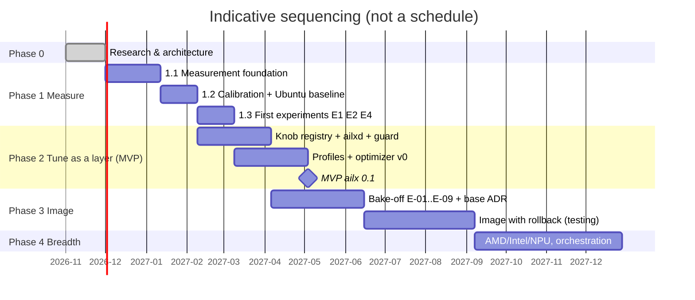

# Roadmap: MVP and Long-Term Research

> Status: Phase 0 proposal · Last updated: 2026-11-26 · Durations are rough planning estimates for a team of 1–3 engineers, not commitments · Priorities from `docs/research/07-opportunity-matrix.md`

## Summary

- **MVP = "ailx 0.1": a layer on Ubuntu 26.04 LTS** that probes the hardware,
  benchmarks reference workloads rigorously against stock Ubuntu (quality and
  energy included), applies a small set of **hardware-validated**,
  runtime-reversible profiles with automatic revert, and publishes
  reproducible reports. No own image in the MVP (ADR-0005).
- Phase order: **Measure → Tune as a layer (MVP) → Image → Breadth**.
  Research tracks run alongside from Phase 2 on.
- The **next development block** is Phase 1 / Block 1.1, "Measurement
  foundation" (see `docs/CURRENT.md`).

## Phase overview

## Phase 1 — Measure (≈ 3–4 months)

| Block | Content | Exit criteria |
|-------|---------|---------------|
| **1.1 Measurement foundation** — ✅ implemented 2026-11-26 (CPU-only CI; hardware pending) — `docs/architecture/phase1.1-measurement-foundation.md` | `ailx-probe` (hardware profile + environment fingerprint, versioned JSON schemas); workload/result manifest schemas; harness core with adapters for llama-bench and `vllm bench serve`/GuideLLM; statistics module (RMIT scheduling, bootstrap CIs, effect sizes, A/A analysis); local result store; telemetry samplers (NVML energy/power, privileged RAPL collector, PSI, wall-meter logger); quality gate v0 (llama.cpp KLD + top-token agreement); unit tests + CI; verification of PK/snippet facts feeding ADRs | Runs end-to-end on any Linux box with a GPU or CPU-only; A/A analysis implemented and unit-tested with synthetic data; schemas documented |
| **1.2 Calibration + baseline** — runbook: `docs/runbooks/first-hardware-run.md` | HW-0, HW-1, HW-2 of the test plan; Proxmox controller setup | Baseline Report v1 with result IDs; A/A false-positive rate within target; noise floors per workload |
| **1.3 First experiments** | E1 (GPU power limit), E2 (MoE offload + CCD placement), E4 (model loading); E9 (quality-gate design) in parallel | Hypotheses H-S-01, H-H-01, H-H-06, H-K-09, H-S-06, H-S-04/05 updated with result IDs |

## Phase 1.3 — Runtime foundation (✅ implemented 2026-11-27, CPU-tested)

`ailx` CLI: status / hardware / resources / doctor / knobs; declarative
profiles (experimental by default); journaled transactions with rollback,
dead-man timer, drift and crash recovery; privileged apply helper; engine
management (llama.cpp, vLLM) with build manifests; system install/uninstall;
profile arms in campaigns. Spec: `docs/architecture/runtime-foundation.md`.
Phase 1.2 (hardware run) is deferred until the workstation is available.

## Phase 1.4 — Packaging & bootable prototype (✅ built 2026-11-27, QEMU-validated)

Native `.deb` (reproducible, lifecycle-tested, CI job); trust-boundary review
of ADR-0011 with fixes; experimental headless reference image on Ubuntu 26.04
with A/B root slots, data partition, trial boot + health check + fallback
(ADR-0012, proposed). Booted and exercised in QEMU/TCG only; hardware boot is
`hw-queued`. This prototype pulls part of Phase 3's mechanics forward for
testing; it does **not** replace the base-distribution bake-off (ADR-0005).
Spec: `docs/architecture/reference-image.md`; results:
`docs/state/image-prototype-report.md`.

## Phase 1.5 — AI Compute Engine foundation (✅ implemented 2026-11-27, CPU/CI-tested)

Groundwork for Phase 2, built ahead of the hardware run (ADR-0010): capability engine (provider
model), GGUF/safetensors analysis, placement planner with memory fit and bottleneck classes, managed
llama-server runtime with admission control, priorities and experimental CPU placement, autotuning
(screening → confirmation → adoption on the existing campaign stack, quality gate for lossy), CLI
`ailx caps|model|recommend|run|tune`, and an automated hardware validation run
(`tools/hw_validate.py`). ADR-0013 (proposed). Covers the Phase 2 rows "MoE/offload planner",
"runtime-parameter tuning" and "Optimizer v0" *mechanically*; the MVP exit criteria (≥1 profile
hw-validated, quality and stability gates) remain open until VL-1.5-* and Phase 1.2 have run.
Spec: `docs/architecture/compute-engine.md`.

## Phase 2 — Tune as a layer → MVP "ailx 0.1" (≈ 3–4 months)

| Area | Content |
|------|---------|
| Control plane | Knob registry (schema + first ~30 knobs with security/quality classes), `ailxd` with journal + dead-man revert (T0/T1), guard policies |
| Profiles | Validated P1 items: power-limit/energy profile, MoE/offload planner, runtime-parameter tuning, prefix caching/speculation presets, memory/PSI policy |
| Optimizer v0 | Screening designs + decision rules + winner re-validation; BO optional; canary suite + change-point detection |
| Experiments | E3, E5–E11 (SCHED_CACHE, offload strategy, memory policy, sched_ext, engines, quality, serving features, GPU sharing) |
| Reuse | Engine gateway via an existing launcher (RamaLama/Lemonade/LocalAI — evaluate), VRAM broker prototype |
| Delivery | deb packages + OCI runtime bundles; CI with SBOM and provenance; tier-2 hosts (Fedora 45, Debian 13, CachyOS) in CI |
| MVP exit | Installable on Ubuntu 26.04; ≥1 profile `hw-validated` on the reference workstation with a significant improvement (or a documented null result); quality and stability gates green; reproducible report |

## Phase 3 — Image (≈ 4–6 months)

Bake-off experiments E-01…E-09 → ADR selecting the image base; image with
atomic updates, boot counting + health checks, CI-signed NVIDIA open modules,
T2 knobs (kernel cmdline/config), soak and rollback drills; first image in the
`testing` channel.

## Phase 4 — Breadth (≈ 6+ months)

AMD and Intel GPU providers on real hardware; NPU provider (needs hardware);
orchestrator with workload classes and VRAM budgets; model store; community
validation network (opt-in); companion mode (workstation + server);
fine-tuning and video workloads in the standard suite.

## Long-term research tracks

| Track | Question | First milestone | Depends on |
|-------|----------|-----------------|-----------|
| **RT-1 CPU scheduling for hybrid inference** | Can AI-aware placement/scheduling (sched_ext, CCD asymmetry, `SCHED_CACHE` interplay, GPU-feeder threads) measurably improve CPU-offload and mixed workloads? | E2/E3/E7 results; then a prototype policy in scx_layered or an own scheduler (#26) | Phase 1–2 |
| **RT-2 Memory tiering for MoE** | Can expert placement driven by access statistics (DAMON-like) across VRAM/RAM/NVMe beat static offload? | Access-pattern traces of MoE models on the workstation | E2, E5 |
| **RT-3 Consumer-GPU multi-tenancy** | VRAM broker → preemptive arbitration (XSched), eBPF GPU policies (gpu_ext), dmem cgroups, drm_sched FAIR | VRAM broker results (E11) | Phase 2, open-module drivers |
| **RT-4 Fast model lifecycle** | How close can load/switch time get to storage bandwidth; checkpoint/restore; compression | E4, E13 | Phase 1 |
| **RT-5 Energy-optimal operation** | Phase-aware power limits/DVFS (prefill vs decode) at fixed SLO | E1 | Wall meter |
| **RT-6 Quality-assurance science** | Which gates and thresholds track user-visible quality per modality; determinism | E9 | Phase 1 |
| **RT-7 Learned and transferable tuning** | Priors from community data, per-op performance DB for consumer GPUs, LLM-assisted proposals within guardrails | Optimizer v0 data | Phase 2, community network |
| **RT-8 Heterogeneous and distributed** | NPU offload of always-on models; multi-node companion mode | NPU test hardware | Phase 4 |
| **RT-9 Secure agents at low overhead** | Measured cost of sandboxing (namespaces, Landlock, gVisor, microVMs) and core scheduling for agent tool execution | Benchmark design | Phase 2 |
| **RT-10 Verifiable results and supply chain** | Reproducible images, signed provenance, verifiable benchmark submissions | E-07, SBOM pipeline | Phase 2–3 |

## What is explicitly not on the roadmap (for now)

A new inference engine, a new compute API, a chat UI, a model hub, a
distributed serving framework, a userspace GPU driver, and any feature that
requires disabling security mechanisms (ADR-0004, ADR-0007,
`docs/research/01-landscape.md` §F6).
